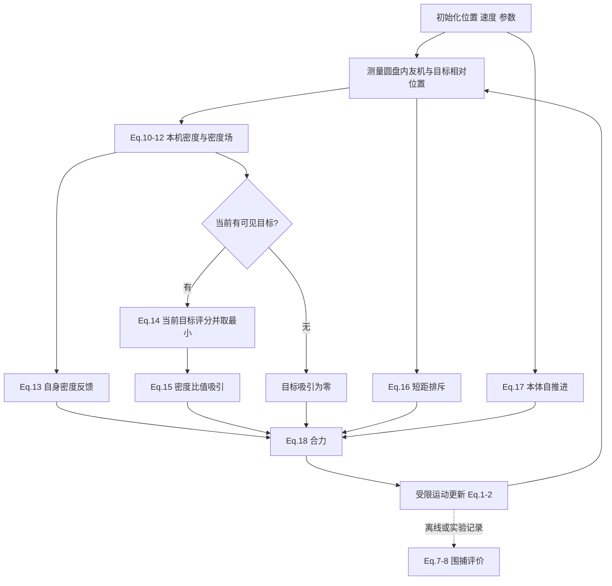

# Density Interaction：公式级中文精读

正式文献：Zhou, Tao, Lei, Peng，Information Sciences 661 (2024), 120119，DOI [10.1016/j.ins.2024.120119](https://doi.org/10.1016/j.ins.2024.120119)。完整 PDF、指纹、源码 commit 和证据标签见 [SOURCE_MANIFEST.md](SOURCE_MANIFEST.md)。本文页码均指原 PDF p.1–21；“补充推导”不是作者提供的证明。

## 阅读入口：这篇论文究竟在控制什么

[原文，p.2–3、6–8] 一个机器人用可见友机位置构建平滑密度场，在自身位置读取密度来决定与友机吸引还是排斥，再在每个**直接可见目标的位置**读取密度，选“密度代价＋距离代价”最低的目标。选定后，目标吸引强度由自身密度与目标处密度的比值决定。每个机器人独立更新这些量，群体可能分裂成若干围捕子群。

[AI判断] 这里不是先求最优人数配额再执行，也不是用密度标量替代所有几何信息。原方法是一套连续力控制器加本机离散目标选择规则；其目标级空间估计和 CoCap 的敌情证据 Z 是不同量。

## 1. Introduction：动机与贡献边界（p.1–3）

[原文] 作者讨论 APF、leader–follower、GRN 图形生成、图方法、行为规则和 RL，关注预设形状、领导节点、额外消息交换、参数复杂以及少量机器人捕多个分散目标时的局限。这里是作者对相关工作的组织与评价，不能理解为所有这些方法都必然有相同缺点。

贡献列在 p.2–3：修改 SPH 平滑核用于机器人密度；围绕期望密度做负反馈；依据目标处密度与相对距离自主选目标，不预设围捕形状、组别或个体角色。

“self-organized”在本文中体现为：同类机器人采用相同局部规则；各自感知、选目标、计算力；子群与围捕形态从交互中出现（p.3、7、15、19）。没有一个独立的自组织公理或正式定义定理。不能将其扩大成“没有任何系统级基础设施”：p.16 的实机实验确实有全局定位和广播。

已有机制与本篇改动应拆开：SPH、密度控制、短距排斥、自推进都已有渊源；本篇 p.2 也明确承认 [39,40] 已用密度场。[39] 是 Lei 等的 *Self-organized multi-target trapping of swarm robots with density-based interaction*（正文参考文献写 2023），[40] 是 *Collective fission behavior in swarming systems with density-based interaction*（Physica A 603, 2022, 127723）。本篇强调把可调期望密度、负反馈与密度—距离选择结合，改善低冗余分群。[AI判断] 本轮只核读了目标论文，不能据其自述宣布某条机制是全领域首次；[39,40] 的优先权需另读原文。

与集中式分配、联盟、角色的区别是执行中没有列出 assignment matrix、联盟成员协议、统一配额或领导者。Eq.(14) 仍然是**显式的本机目标选择**，不能因为没有全局分配就说“没有任何选择逻辑”。

## 2. Preliminaries：模型与信息权限（p.3–4）

### 2.1 环境、集合、动力学：Eq.(1)–(2)

[原文，p.3] 二维、无环境障碍的平面；同质 hunters 与同质 moving prey。感知区域是以自身为中心的圆盘，描述为约自身半径 30 倍；p.8 实际为 7/0.2=35 倍，p.16 实机为 1000/30≈33.3 倍，“约30”不是精确参数。

目标集合 `P={p_1,…,p_m}`，围捕机器人集合 `N={n_1,…,n_n}`。`r_i=(x_i,y_i)` 是位置、`v_i` 是速度、`m_i` 是质量（原文英文写 weight），`F_i` 是合力。

$$m_i\dot{\mathbf v}_i(t)=\mathbf F_i(t).\tag{1}$$

$$\begin{cases}\dot{\mathbf r}_i(t)=\mathbf v_i(t),\\
\dot{\mathbf v}_i(t)=\frac1{m_i}\mathbf F_i(t).
\end{cases}\tag{2}$$

对所有 hunters/prey 成立，默认 `m_i=1`。作者施加最大加速度/力和速度约束，要求 `v_p,max<v_n,max`；这是能追上可见目标的设定，不是对任意更快目标的捕获保证。正文没有指定积分器、仿真 Δt、向量/分量限幅和饱和顺序。

**信息获得者**：每个机器人感知范围内所有实体的空间分布并识别友机/目标类别，只使用这些数据决策，不要求消息交换（p.3；p.8再次明确）。控制器用本体速度计算自推进；没有需要邻居速度一致性的 alignment 项。

### 2.2 信息条件逐项审计

| 维度 | 原文可支持的结论 | 不能补成的结论 | 依据 |
|---|---|---|---|
| 目标感知 | 本机圆盘内目标；仿真 7m，实机模拟局部视野 1000mm | 初始全部目标都可见、传感器任意远 | p.3、8、16 |
| 初始目标清单 | 全场目标集合是模型/评估记号，未要求每机知道完整清单；Fig.9 初始只看到一个目标 | 因写了 P 就存在全局目标数据库 | p.3、7、11–12 |
| 目标坐标 | 决策要直接可见目标相对位置/距离/方向，在本地场中查询 | 只需一个与目标无关的标量；完全不用测距 | Eq.(12)、(14)–(16)，p.6–7 |
| 目标身份 | k 为当前观测目标索引，能够区分同时可见实体并选其中一个 | 全局一致 target ID、跨机同目标协议、永久跟踪记忆 | Eq.(14)；未给 ID 协议 |
| 友机感知 | 可见友机相对位置，计算核和梯度；不必读其目标选择 | 必须交换友机所属联盟或选择结果 | Eq.(10)–(13)、(16) |
| 友机速度 | 控制律没有邻居速度项，本体速度必须有 | 传感器一定不能测速度、或算法必需全体速度 | Eq.(4)、(17) |
| 理想通信 | 无显式机器人间消息；感知关系随相对位置变化 | 没有中央决策就自动无通信 | p.3、8 |
| 实机通信 | NOKOV 追踪所有机器人位置、朝向；2.4G RF 广播全局信息，每机截取局部数据 | 实机纯机载感知、无线链路不存在 | p.16；p.18提到中央与机器人通信延迟 |
| 目标信息传播 | 理想算法不传坐标、速度、ID，也没有 Z 一类标量传播 | “密度方法”默认就是密度消息转发 | Eq.(11)–(15) |
| 密度 | 本机可见友机形成的 Q_i，在可见目标位置取值；不是全群真实密度 | 每机对同一目标得到相同密度 | Eq.(12)；Fig.7 |
| 分配 | 本机 argmin；无人数配额/显式联盟 | 全局最优、公平人数或全部目标必获三机 | p.7、14–15 Fig.11–12 |
| 执行/评价 | 算法分布式本机计算；仿真与实机评价可读全状态 | 统计指标也是机器人执行输入 | p.4、15–16 |

[AI判断] 原生执行不需要跨机器人判断“我们看见的是同一个目标”。每机只需在当前视野里定位可见对象。若要让**未见目标**的远处机器人也形成目标级密度共识，那是另一种设计，才会引入坐标/身份关联需求。

### 2.3 Dynamics of targets：Eq.(3)–(6)

[原文，p.3] 目标不是任意最优对手。它对可见 hunters 统一排斥，对其他 prey 短距排斥，并有自推进：

$$\mathbf F_k=\mathbf F_k^{self}+\mathbf F_k^{esp}+\mathbf F_k^{rep}.\tag{3}$$

$$\mathbf F_k^{self}=(\alpha_k-\zeta\|\mathbf v_k\|^2)\mathbf v_k.\tag{4}$$

`α_k` 为自加速系数、`ζ` 为阻尼/摩擦系数，`v_k` 为本体速度。本项不需要友机通信。

[补充推导] 单独看自推进并令速度模长 s>0，`ds/dt=(α_k-ζs²)s/m_k`，正平衡速度 `sqrt(α_k/ζ)`；低于该值加速，高于它减速。但 **s=0 时该项也为0**。作者称可从静止加速（p.3），实际若恰好静止且其他合力也为0，本项不能自行启动。给随机初始速度或扰动需标成实现选择。这个单项平衡速度也不是整个相互作用系统的严格速度上界；p.8 另设 vmax。

$$\mathbf F_k^{esp}=-k_{esp}\sum_{i\in N_k}
\frac{\|\mathbf r_{ik}\|}{(\|\mathbf r_{ik}\|+d_0)^2}\hat{\mathbf r}_{ik}.\tag{5}$$

这里 `r_ik=r_i-r_k` 是目标 k 指向 hunter i 的向量，单位向量 `hat r_ik` 同向；负号使目标远离 hunter。`N_k` 是目标可见 hunters，`k_esp>0`、`d0>0` 是常数。

[补充推导] 令 d 为距离，`g(d)=d/(d+d0)²`，则 `g'(d)=(d0-d)/(d+d0)³`。d>d0 时靠近使逃逸力增大；d<d0 时继续靠近，力反而减小；最大值在 d=d0。原文后半句写“d0<0”与正值定义冲突，应保留为原文疑点，而不是把负 d0 输进代码。[AI判断] 近距离逃逸减弱是目标模型对“被围困”的特殊响应，不能换成更强对手后仍沿用原始捕获结论。

$$\mathbf F_k^{rep}=-k_{rep}\sum_{i\in P_k}
\frac{\hat{\mathbf r}_{ik}}{\|\mathbf r_{ik}\|^3}.\tag{6}$$

`P_k` 是目标 k 可见的其他 prey，`k_rep>0`。同样使用目标指向邻居方向与负号；幅值为距离三次方倒数，促使 prey 分散。理想奇异力不等于带限幅、离散积分和有限体积机器人的严格不碰撞证明。

### 2.4 The metrics of trapping：Eq.(7)–(8)、Fig.1（p.4）

[原文] 每个 hunter 有一个直径等于自身体长5倍的半圆防御区，其直径方向垂直于猎手—目标连线。Fig.1 画的是这些防御区遮挡之后目标剩余的逃逸扇区。

$$\theta_{rest}=\max_{e\in\text{all escape angle}}\theta_e.\tag{7}$$

`θ_e` 为逃逸扇区角度，`θ_rest` 为最大剩余逃逸角。注意它不是“相邻 hunter 中心方位角的最大间隔”；防御区域有宽度，会遮挡一段视角。

$$d_{kt}=\min_{i\in N_k}\|\mathbf r_{ik}\|.\tag{8}$$

是目标到最近可见 hunter 的距离。正文成功状态描述为 `θ_rest<30°` 且 `d_kt` 收敛到 `<d0` 的常数。没有指定趋稳容差、连续保持几步、首次成功停机/移除目标或任务终端实现。

[AI判断] 这是有几何含义的形态指标，加近距离稳定条件；既不能简化成“最近距离小于阈值即抓住”，也不能转换成 CoCap normal：后者对 capture_distance 内中心方位角间隔检查，不扣除半圆防御扇区。Fig.1 对防御区给了几何描述，但没有一套处理重叠/遮挡/角度 wrap、容差的可执行评估伪代码。

## 3. Methodology：核、场、力与选择（p.4–8）

### 3.1 SPH smoothing function：Eq.(9)–(10)、Fig.2

[原文，p.4–5] SPH 用具有光滑性、正值、归一、对称、紧支撑等性质的核，把离散粒子的影响平滑叠加。原文 Eq.(9) 列三种候选，以下保留印刷形式与原编号：

$$\begin{aligned}
W_{Bell}(\lambda,h)&=\alpha_d\begin{cases}(1+3\lambda)(1-\lambda)^3,&\lambda\le1,\\0,&\lambda>1;\end{cases}\\
W_{Quadratic}(\lambda,h)&=\alpha_d\begin{cases}\frac3{16}\lambda^2-\frac34\lambda+\frac34,&\lambda\le2,\\0,&\lambda>2;\end{cases}\\
W_{\text{Cobie spline}}(\lambda,h)&=\alpha_d\begin{cases}\frac32-\lambda^2+\frac12\lambda^3,&\lambda\le1,\\\frac16(1-\lambda)^3,&1<\lambda\le2,\\0,&\lambda>2.\end{cases}
\end{aligned}\tag{9}$$

`λ=r/h≥0`，h 为平滑长度，r 为两点距离，`α_d` 为与维数和 h 有关的归一系数。原文对应 bell 的一/二/三维系数是 `5/(4h), 5/(πh²), 105/(16πh³)`；正文所列 cubic 为 `1/h,15/(7πh²),3/(2πh³)`，quadratic 为 `1/h,2/(πh²),5/(4πh³)`。

**核对疑点**：原印 “Cobie spline” 的第二段在 1<λ≤2 为负，与前述正性冲突，第一段与第二段也不能据此得到正常平滑衔接。这里不是推荐实现该候选；作者实际使用 bell-shaped。不能替换成自己记得的标准 SPH 样条后称为原论文 Eq.(9)。

为少量宏观机器人，作者取消积分归一要求，改幅度并把支撑半径设为感知半径：

$$W(\lambda)=\frac{R_i}{R_{sen}}
\begin{cases}(1+3\lambda)(1-\lambda)^3,&\lambda\le1,\\0,&\lambda>1.\end{cases}\tag{10}$$

`λ=r_ij/R_sen`、`r_ij=||r_i-r_j||`，`R_i` 是 hunter 本体半径，`R_sen` 是感知半径。之后 Eq.(11) 等写 W(r)，属于省略归一参数的记号；实际应将距离除以 R_sen 再代入。W(0)=R_i/R_sen，是本体对密度的贡献。默认仿真约0.028571。

[补充推导] 令 C=R_i/R_sen，`f(λ)=(1+3λ)(1-λ)³=1-6λ²+8λ³-3λ⁴`，则：

$$f'(\lambda)=-12\lambda(1-\lambda)^2,\quad
\frac{dW}{dd}=-\frac{12R_i}{R_{sen}^2}\lambda(1-\lambda)^2\quad(0<d<R_{sen}).$$

因此近者贡献大、到支撑边界归零；梯度幅值在 λ=1/3 处最大，中心与边界为0，符合 Fig.2。方向梯度必须连同对哪个坐标求导来定义，不能只用 Fig.2 的一维负导数决定吸/斥方向。

W 是人工无量纲拥挤度，不是质量/面积的物理密度；`ρ0` 与 W 的幅度合同配套。改变 R_sen 会同时改变可见邻居数、核宽、核幅度，不能直接认为保持同一 ρ0 就等效。

### 3.2 Robot density and its field：Eq.(11)–(12)、Fig.3（p.5–6）

$$\rho_i=W(0)+\sum_{j\in N_i}W(r_{ij}).\tag{11}$$

`N_i` 是本机 i 可见的其他 hunters。每一项来自本机相对测距；不包括 prey 作为密度源。i 本地求和，无需听取每个 j 的密度或目标 ID。

$$Q_i(\mathbf x_i)=W(\|\mathbf x_i\|)+
\sum_{j\in N_i(\mathbf x_i)}W(\|\mathbf x_i-\mathbf r_j\|).\tag{12}$$

保留原文 `N_i(x_i)` 记号。正文说明这是 focal robot 可见的 hunters（j∈N_i），在其可感知平面上构造场；没有定义“x_i 处隐身邻居数据请求”。首项以本机为原点，其他 r_j 也应在该局部坐标里表示。

[AI判断／信息可实现性展开] 在以 i 为原点的相对坐标中，令 `u_ij=r_j-r_i`、`u_ik=r_k-r_i`，则目标处场可由当前测量展开为：

$$Q_i(\mathbf u_{ik})=W(\|\mathbf u_{ik}\|)+
\sum_{j\in N_i}W(\|\mathbf u_{ik}-\mathbf u_{ij}\|).$$

这是 Eq.(12) 的局部坐标解释，非新增原文公式编号。目标和友机位置需在同一本机坐标系；两者相减可得目标—友机距离。只要每个局部目标可区分，就无需跨机 target ID。距离噪声下，这个相减也会把测量误差带入场估计。

重要限制：`Q_i(r_k)` 只叠加 **i看得见** 的 hunters。目标背面若有机器人位于 i 感知圆外，它们不进入该估计。即使同一目标，Q_i 与 Q_l 也可不同；该量不是目标自己的 `ρ_k`，也不是分配给目标 k 的真实人数。一个经过目标附近、实际追别的目标的机器人也会贡献核。这正是 Fig.12 失败解释的重要线索。

Fig.3（p.6）逐面板：A 为黑色 focal 加19个红色邻居，蓝圆为7m感知范围；B 将20个核叠加为密度场；C 以期望密度0.1映射出吸引/排斥区域；D 显示相应向量场和局部放大。图用于解释局部计算，不表示机器人获知图外实体，也不是全局控制地图。

### 3.3 Density negative feedback：Eq.(13)（p.6–7）

$$\mathbf F_i^{col}=k_{col}\left[1-\left(\frac{\rho_i}{\rho_0}\right)^3\right]
\sum_{j\in N_i}\nabla W(\mathbf r_{ij}).\tag{13}$$

`k_col>0` 控制交互强度；`ρ0` 是期望个体密度；`ρ_i` 来自 Eq.(11)；梯度来自本机对友机相对位置的核导数。ρ0、k_col 是预设参数；无目标身份信息。

[原文] 自身密度小于期望则吸引，高于期望则排斥。二到七次幂的实验“满意但无特定最优”，选三次；没有完整次数消融表（p.7）。

[补充推导] 设 q=ρ_i/ρ0，调节器 `b(q)=1-q³`。q<1 时 b>0；q=1 时 b=0；q>1 时 b<0。令 ρ_i=ρ0+ε，则 `b≈-3ε/ρ0`，超密后负反馈随偏差迅速增强。这个代数性质说明反馈方向，**不构成所有耦合运动的稳定性证明**：ρ_i 会随邻居位置与可见集合变化，且总力还有三项。

方向审计：若定义 `r_ij=r_i-r_j` 并对 r_i 求梯度，则 `∇_i W=W'(d)(r_i-r_j)/d` 指向 j，乘正 b 为吸引、乘负 b 为排斥。p.7 梯度方向文字与若干向量定义并不完全一致；复现必须明示求导变量与单位方向，不能逐字拼接相冲突的方向叙述。

密度正好等于ρ0，也不代表机器人静止，因为目标吸引、短距斥力和自推进仍在。图中的各机器人稳态密度不必完全相等，也不必等于ρ0。

### 3.4 Target self-regulated selection：Eq.(14)（p.7）

$$press_i(k)=Q_i(\mathbf r_k)\,\beta_1+\beta_2 r_{ik},\qquad k\in P_i.\tag{14}$$

`P_i` 为本机直接可见 prey；`r_ik` 此处是距离标量；`Q_i(r_k)` 为目标在本机场中的值；`β1,β2` 是权重（正文未单列其取值约束；默认20、0.2）。选择 `p_choose=argmin_{k∈P_i}press_i(k)`，该 argmin 由相邻文字给出，不另编算法编号。

数据来自哪：目标相对位置直接感知，友机相对位置形成 Q_i；本机对各目标独立评分，没有询问“谁已领任务”。目标 ID、其他机器人的选择、全局人数 N/M 均不在式中。同值时选谁、是否保留上一步目标、每物理子步还是每决策步切换，正文未规定。

[补充推导] 比较 A、B：当

$$\beta_1(Q_A-Q_B)+\beta_2(d_A-d_B)<0$$

时选 A。默认权重下，`Q_A-Q_B=0.01` 对应0.2代价，相当于1m距离差。因此更远但足够低密度的目标可以胜出；不是无条件优先远目标，也不是无条件选最近目标。单个机器人改选后，其空间移动改变附近其他机器人看到的 Q，于是产生反馈；这才是“多个目标竞争资源”的实现。

[AI判断] 这种竞争没有全局最优性或严格配额。平均人数接近 N/M 是实验结果，N/M 没有输入到控制器。尤其 Q 的高值可能来自路过者或邻近另一目标的捕手；不能把 `press` 解释为“该目标已具备足够三机”。

### 3.5 Target attraction：Eq.(15)（p.7）

$$\mathbf F_i^{tar}=\frac{k_{tar}\rho_i}{Q_i(\mathbf r_{p_{choose}})}
\hat{\mathbf r}_{i p_{choose}}.\tag{15}$$

`k_tar>0` 为目标吸引系数；单位向量明确指 i 到选定 prey；分子是自身密度、分母是目标在本机场中的密度。所有量均可由本机位置测量与自身状态计算，无需目标速度或邻居通信。

[补充推导] 只固定ρ_i 看分母，吸引幅值 A=k_tar ρ_i/Q：`∂A/∂Q=-k_tar ρ_i/Q²<0`。目标处越拥挤，吸引越弱。反过来固定Q，ρ_i 增加会使吸引增强；所以不能不加条件地说“密度增加必然削弱吸引”。真正变化由比值决定。若ρ_i与Q同比增大，比值不变。

原文解释：远处稀疏目标往往 Q≪ρ_i，吸引强；靠近后 Q≈ρ_i，幅值趋近 k_tar。配合 Eq.(13) 超密排斥和 Eq.(16) 短距斥力，冗余捕手可能留在外围或转去其他可见目标（Fig.6–7，p.10–11）。没有为捕获圈设计固定半径或角位置，不能把 Eq.(15) 说成环形误差跟踪器。

数值边界：只要目标严格处在自身核支撑内，Q至少包含正的本体核贡献。但目标恰在 R_sen 边界且无其他贡献时 Q=0；靠边界可能极小。论文未给 `epsilon`、clamp 或异常处置。p.8 的 Fmax 表明有总输出约束，却没有说明先求各项还是先截断，无法用它自动消除0/0或除零问题。

### 3.6 Collision repulsion：Eq.(16)（p.7）

$$\mathbf F_i^{rep}=-k_{rep}\sum_{j\in(N_i,P_i)}
\frac{1}{\|\mathbf r_{ij}\|^3}\hat{\mathbf r}_{ij}.\tag{16}$$

[原文] 对所有可见 hunters 与 prey 都起分离作用；此处 `(N_i,P_i)` 按文字为两类集合的合并，不是有序对笛卡尔积。密度反馈本身不足以避碰，因此另加这项。

必须保留的方向冲突：同段写 `r_ij=r_i-r_j`，又写 `hat r_ij` 是 from i to j。二者相反。按“from i to j”并保留负号才能得到排斥；若按向量差的字面方向归一后再乘负号，将得到吸引。[AI判断] 本次不替作者发布勘误，交接标 `PARTIALLY_VERIFIED`；复现说明必须记录选用的方向解释。

理想点力 d→0 时发散。但系统有 Fmax/amax、有限感知、执行延迟和离散积分；论文未给 barrier certificate、最小安全距离不变集或受限输入可行性证明。p.18–19 实机确实碰撞甚至翻转，因此不能把“引入避碰斥力”写成“严格安全”。

### 3.7 Self-driving force、合力：Eq.(17)–(18)（p.7–8）

$$\mathbf F_i^{self}=(\alpha_i-\zeta\|\mathbf v_i\|^2)\mathbf v_i.\tag{17}$$

符号与 Eq.(4) 一致，数据是本体速度。没有给随机游走、覆盖地图或信息素。该项沿已有速度方向调幅，在零速无其他力时不自主产生方向。

$$\mathbf F_i=\mathbf F_i^{col}+\mathbf F_i^{tar}+\mathbf F_i^{rep}+\mathbf F_i^{self}.\tag{18}$$

这是送入 Eq.(1)–(2) 的总控制力。无可见目标时 `F_i^tar=0` 有 p.10 Fig.7(a1) 的明确说明。其他力可让外围机器人跟随群体，但没有 Z 支援消息，也没有承诺一定发现孤立未知目标。

### 3.8 按执行顺序重建流程

以下是基于正文的执行依赖整理，**不是论文原有 Algorithm 1**。

1. 初始化：p.8 默认半径5m圆盘内随机散布；p.11 Fig.9 是专门布局，不套用默认。
2. 发现：几何上进入本机感知圆盘后加入 P_i。没有全局发现表或坐标接力。
3. 密度：用可见 hunters 加自身核；在自身/候选目标位置取样。
4. 局部交互：ρ_i 与ρ0比较决定聚/散；不同机器人有不同局部场。
5. 选择：在可见目标内用 Eq.(14) 选一个；没有固定人数的联盟。
6. 控制：四项合力、受限运动；目标按 Eq.(3)–(6) 逃逸。
7. 捕获评价：形态与距离（不同统计实验可能用代理指标，见下）。正文未给统一终止器。
8. 捕获后：展示持续围困，不给移除、释放、返航、恢复覆盖协议。
9. 新目标到达：当前进入视野的目标原则上可评分；但在线生成、重复波次、捕获后再搜索没有原生实验或完整流程，不得宣称已支持。

## 4. Simulation results：逐图与统计口径（p.8–16）

### 4.0 原始默认参数与场景

下表是本笔记整理表，**原文没有 Table 1**（p.8）。

| 参数 | hunters | prey | 解释 |
|---|---:|---:|---|
| 本体半径 | R_i=0.2m | R_k=0.2m | 圆形个体 |
| 感知半径 | R_sen=7m | R_ksen=7m | 本机中心圆盘 |
| k_rep | 5 | 5 | 各自碰撞排斥项 |
| k_col | 20 | 不适用 | hunters 密度反馈 |
| k_tar | 7 | 不适用 | 目标吸引 |
| k_esp | 不适用 | 0.5 | 逃逸 |
| α | 0.1 | 0.1 | 自推进 |
| ζ | 2 | 2 | 自推进阻尼 |
| β1,β2 | 20,0.2 | 不适用 | 密度/距离选择权重 |
| ρ0 | 0.2 | 不适用 | 专项实验另改 |
| d0 | 不适用 | 1m | 逃逸力峰值距离／成功距离参照 |
| vmax | 5m/s | 3m/s | 截断上限，不是 sqrt(α/ζ) |
| Fmax | 5N | 5N | 另述 m=1，未给饱和执行顺序 |

默认全体在原点半径5m圆盘随机分布。场景是无环境障碍平面，没有给定“有围墙的固定10×10m地图”；初始圆盘是出生分布，运动可离开它。初始化特意使机器人看到尽量多实体，不能当作大面积所有目标均未知且全部视野为空的搜索评估。目标为 Eq.(3)–(6) 的运动猎物，Fig.9 单独设静止目标。

### 4.1 Density negative feedback control：Fig.4–5（p.8–10）

**Fig.4，p.8；解释p.9。** 50个无目标机器人，九种期望密度 `ρ0=1,0.8,0.6,0.5,0.4,0.3,0.2,0.1,0.05`。A 中颜色是各机ρ_i，不能当作分组标签；B 画最小/最大互距和最小/最大个体密度随ρ0变化。

[原文数值] ρ0 从1降到0.05时，最小互距从0.2868增到2.0896，最大互距正文报5.3131→26.0650；个体最大密度0.9531→0.0562、最小密度0.5543→0.0367。图4B曲线可用于看趋势，不能由低分辨率估读覆盖正文数值。

[AI判断] ρ0调的是群体空间尺度与稀疏程度，不保证所有ρ_i精确跟踪ρ0。ρ0=1时最小中心距0.2868小于两半径和0.4，至少说明不能把这些几何数值与圆体严格无交叠混为一谈；正文没有给仿真碰撞统计与接触处理。

**Fig.5，p.9；解释p.9–10。** 同样50机，每300 iterations改变一次参考值。图中阶段为0.5→0.3→0.2→0.1→0.2→0.3→0.5；上方快照截至2100步，曲线显示超调和振荡后趋于新状态。它支持“动态改变ρ0可以调群体尺度”，没有证明在任意目标干扰、任意初态、任意参数下全局收敛，也不能把iterations直接换成秒。

### 4.2 Single target：Fig.6–8（p.10–12）

**Fig.6，p.10。** N=5、10、20、30、40、50 对单目标的最终形态。少量时围绕目标相对均匀；数量较多，近目标群体密度饱和，部分机器人留在外围或远处。不是“50台都会紧密均匀围成一个圆”。颜色表示密度，箭头表示速度。

**Fig.7，p.11。** 放大N=20时的三个机器人视角：a1目标在视野外，因此F_tar=0，靠群体交互和自推进跟随；a2目标可见但Q_target远大于ρ_i，吸引不足以压过排斥；a3近目标时密度比接近1，可停留围困。三个视角共同证明Q是**本机局部场**，不是全体机器人共享一张目标热力图。

[AI判断] 这种饱和比一味增强目标吸引更有解释性，但冗余个体落后不自动等于“去搜索未发现的新目标”。没有局部新目标时它们可能只是跟随或散开。

**Fig.8，p.12；文字p.11。** 3机围1目标：A给初态、轨迹、末态防御半圆；b1逃逸角降到30°以内；b2最近距离约0.85m，小于d0=1m，后续振荡减小；b3个体密度趋稳。支持某个设定和初态下三机可围困，不能推出“三机对任意初态/更快目标必胜”，也不能把防御半圆扣除后的30°套成 CoCap 中心角间隙30°。

### 4.3 Target selection and multi-target：Fig.9–10（p.11–13）

**Fig.9，p.12；文字p.11–13。** 10机、3个静止目标。初始群体在某个目标一侧，每机初始只能看见一个目标；随后其他目标进入视野，低密度和距离竞争使机器人改选，最终分为三组。A给初终态及轨迹；B以10、30、60、90 iterations展示绿色 focal 的局部场，白弧为感知边界。

这是“并非初始全知”最直接证据；也是有限范围发现与动态改选的例子。但任务起始已经有可见目标，没有实验验证从所有机器人完全看不到任何目标开始，对未知地图做持续系统搜索。

**Fig.10，p.13。** 5个运动目标的典型多目标围困。图A快照在50、70、90、120 iterations；B完整轨迹；C为逐目标逃逸角、最近距离和各hunter密度。正文说中央目标早期受到短暂包围后被忽略，后有冗余个体再来；最终θ_rest<30°，d_kt趋于约0.9m（<1m），ρ_i约0.1。图注与对应文字未直接标定hunter总数，本次不凭目视给它一个未经原文明确标注的 N。

[AI判断] 一个全目标成功轨迹证明可实现性，不提供总体成功率、平均完成时间、置信区间，也不说明内部目标被忽略问题总能恢复。

### 4.4 Robustness and scalability：Fig.11–13、Eq.(19)（p.13–16）

**Fig.11，p.14；定义与解释p.15。** N=30或50，目标M=2…10，每个条件50次。A给N=30/50、M=7/10的轨迹例子；B含四面板：b1、b3是失败概率中0/1/2追捕者对应比例，b2、b4是各目标分群规模分布与N/M参照线。

`n_trap` 是最终追捕/围捕组规模；`P_fail` 被定义为所有目标中不成功目标比例，0、1、2个追捕者视为不成功。**这不是“每局所有目标都成功”的概率**。组成员的精确自动识别阈值和统计实现未给代码或伪代码。N=30时M>6出现失败并随目标数增长；N=50显著改善。平均组规模在N/M<10时趋近该比值，但不是每个目标强制相同人数。

**Fig.12，p.14；解释p.13、15。** 蓝圈标出最终未被围困的 focus target；黑圈是该目标可被感知的距离示意。1、30、60、90 iterations的快照显示：初态目标夹在猎手与其他目标之间，局部Q看起来已高，机器人偏向其他更低密度目标；后来所剩追捕力不足，出现逃逸。

[AI判断] 失败来自几何密度与有效围捕能力并不等价。目标附近“有人”不等于有人朝它形成角度覆盖；原方法没有人数需求、角隙反馈或同目标服务承诺。对 CoCap 最有价值的反证恰在这里：不能只用高Z友机数量宣称某个目标已饱和。

距离噪声公式为：

$$\mathbf r_{ij}^{noise}=(1+\xi\delta)\mathbf r_{ij},\quad\delta\sim U(-1,1).\tag{19}$$

[原文，p.15] `ξ>0` 是噪声强度，j可为可见hunter或prey，**只改变相对距离，不改变方位方向**。正文列ξ={5%,10%,20%,30%,35%,40%,50%}；每强度100次，20猎手追4目标。

**Fig.13，p.16。** A给5%、10%、20%、40%轨迹；b1分群规模箱图仍约5；b2失败概率随噪声增大而上升，正文说至35%仍低于12%。横轴还多出60%（图文不一致，保留待核）；不要从柱图估读到小数点后再伪装成原始统计表。

判据也变了：作者明确因噪声下距离不再稳定，用θ_rest<30°判断形态成功，而没有再要求d_kt收敛。不能把这组“噪声失败率”与Fig.11的人数代理、无噪声形态+距离成功无缝合并。

[AI判断] 本实验支持特定幅度的**距离噪声**下分组与形态的鲁棒性；不支持方向噪声、漏检/遮挡、身份误关联、丢包或未知搜索鲁棒性。Eq.(10)、(12)、(14)、(16) 仍明确使用距离；“不依赖绝对距离构型”不是“不用距离信息”。同样，结尾偶有 heterogeneous 字样，不能覆盖p.3同质模型并变成“已系统验证异质机器人”。

### 4.5 本文没有给出的比较

全文没有编号表格，没有与APF/GRN/RL/联盟算法在同信息条件下的定量baseline对照，没有独立的Eq.(14)移除消融或β1/β2二维敏感性图。主要改变的是ρ0、个体数/目标数、测距噪声和实机故障。没有统一平均完成时间表、吞吐量表、碰撞率表或多训练种子概念；这里是非RL方法，随机仿真重复不能写成训练重复。

## 5. Robotic experiments：实际系统不等于理想传感合同（p.16–19）

### 5.0 硬件、通信、底层执行：Fig.14（p.16）

[原文] SwarmBang差速小车约60×60×60mm，实验区约6000×6000mm。NOKOV采集**所有机器人位置和朝向**，2.4G RF自定义协议将全局信息广播至各车；每车基于全局消息中取得的局部信息独立决策。没有提供帧格式、无线有效半径、带宽或严格局部过滤的逐字段审计。

因此可以写“局部算法输入由全局定位系统模拟”，不能写“实机没有通信”。正文p.18还把中央与车之间通信延迟列为噪声来源；分布式决策和通信基础设施同时存在。

差速执行：`Δθ=θ_d-θ`，`ω=Δθ/Δt`，Δt=0.2s，角速度上限47.75deg/s；线速度离散映射：

| 期望 v_d（mm/s） | 执行 v（mm/s） |
|---|---:|
| v_d≥20 | 20 |
| 10≤v_d<20 | 10 |
| 0.1≤v_d<10 | 5 |
| v_d<0.1 | 0 |

正文未给速度/方向从连续合力得到的完整离散更新器、角差wrap约定、期望速度标量正负约定，不能把上表直接当完整差速控制源码。

p.16原始实机参数：

| 参数 | hunters | prey |
|---|---:|---:|
| R | 30mm | 30mm |
| 感知半径 | 1000mm | 1000mm |
| k_rep | 1.3 | 1.5 |
| k_col | 10 | — |
| k_tar | 80 | — |
| k_esp | — | 1.5 |
| α, ζ | 0.6,0.1 | 0.6,0.1 |
| β1,β2 | 35,2 | — |
| vmax | 20mm/s | 10mm/s |
| amax | 50mm/s² | 50mm/s² |
| d0 | — | 原印150m；p.18写150mm |

实机ρ0没有在默认参数段给一个所有场景共用值；Experiment1明确变0.1→0.5，多目标实验的ρ0正文未明确重列，不能擅自套仿真0.2。猎手起始在中部，目标置外部，但“外部”不能自动解释为所有车都看不到目标；Fig.16只写目标初始不在围捕圈。

### 5.1 Experiment 1：Fig.15（p.17）

30猎手、无目标，前80秒ρ0=0.1，之后改为0.5。A为1、14、85、120、200s快照；B为全轨迹；C给最小/最大互距和个体密度极值。先扩散后收缩，最后ρ_i最大约0.55、最小约0.39。最终形状不是理想圆区，作者解释为阶梯速度响应不足。

支持可调密度在差速硬件上可实现；并不证明ρ_i精确等于参考值，不是目标搜索评估，也不是纯机载感知验证。

### 5.2 Experiment 2：Fig.16（p.17–18）

24猎手、6运动目标。A轨迹，B快照，C逃逸角、hunter密度、逐目标最近距离。最终5目标围困，另1个仅两车追逐、未成功。60→75s左上两个目标之间出现冗余车转移，7车最终分围两目标，是实机资源再分配的直观例子。

作者明确说明实际碰撞可致突然旋转、迟滞、翻车，并影响动捕测量。不能把这段转换成“碰撞规避已经完成”。图中时间为单次轨迹，不是多次统计平均完成时间；也不能把单次5/6写成可泛化的83.3%实验成功率。

### 5.3 Experiment 3：Fig.17（p.18–19）

初始24猎手、6目标，随机让5车停止，成为静止障碍；剩19车围住5目标并追逐1目标。A绿色是停机车，B快照到84s，C仍有一个目标的逃逸角未达阈值。支持同规则在某次故障后还能维持多群围困；未建立对任意故障率、复杂障碍或任务完整成功的保证。

作者称这验证了处理障碍与分布式决策；[AI判断] 实验障碍主要是停机机器人，不能当作复杂地形、遮挡传感器和窄通道通用规划验证。正文结论p.19也承认尚未考虑场景变化。

## 6. Conclusion、理论性质与作者自述边界（p.19–21）

[原文] 总结密度负反馈、密度—距离选择、局部相对位置和无显式信息交换；未来拟加强环境/机器人交互，甚至借场景帮助低速捕手围困高速目标。后者是展望，当前p.3仍采用追捕者最大速度更高。

p.20给CRediT、基金62076203及Data availability“按请求提供”；没有开源代码链接。参考文献45项，其中[39,40]为密度前驱，[41–44]为SPH/密度控制相关脉络。这些引用说明来源，不代表本次另行精读了它们。

| 性质 | 本文做到什么 | 不能声称什么 |
|---|---|---|
| 密度调节 | 反馈符号解释与仿真/实机动态响应 | 所有ρ_i全局渐近收敛到ρ0的证明 |
| 环形/包围 | 几何逃逸扇区指标，若干围困轨迹，形状自由 | 固定半径等角圆环收敛定理 |
| 无逃逸 | 目标模型内有成功个案 | 任意对抗策略/更快目标/任意初态不逃逸 |
| 安全 | 奇异短距斥力、输出约束 | 受限输入下严格无碰撞；实机证据相反 |
| 分配 | 局部贪心+运动反馈导致分群 | 最优分配、人数下界配额或全目标必服务 |
| 通信 | 理想算法无需显式队间消息 | 实机没有全局广播与中央测量 |
| 搜索与生命周期 | 有限视野内发现其他目标，自推进 | 完整未知搜索、释放、恢复覆盖、重复到达 |

[AI判断] 全文没有Lyapunov函数、收敛定理、概率完备搜索证明或可达性/微分博弈证明。将单项自推进速度平衡、核导数或负反馈符号推导称为整队闭环稳定性证明，会超出原文。

## 7. 给 CoCap 的精读结论

详细13维对照、局部支援饱和和A/B/C适配分界见 [专项分析](COCAP_RELEVANCE_AND_ADAPTATION_ZH.md)。给复现 Agent 的原文模块、参数和缺项见 [交接](REPRODUCTION_HANDOFF_ZH.md)。

最核心的迁移判断是：[AI判断] 在可见目标相对位置与可见友机位置已有的前提下，可构建“本机可见集下的目标邻域拥挤度”；这不要求目标ID广播，但 CoCap 的VorAdj邻居和8-token截断并不是论文7m圆盘内的全部hunters，因此是适配估计，不是同一Q。对于未直接看到目标的支援者，Relative-Z只表明沿友机链传来的敌情证据，既不给目标位置，也不给同目标人数，不能直接代入 Eq.(14)–(15)。

复现是否忠实，必须同时对齐感知集合、运动模型、目标逃逸模型、核参数与指标。只复制 `1-(ρ/ρ0)^3` 到另一奖励函数里，不能称为已复现整篇Density Interaction。
